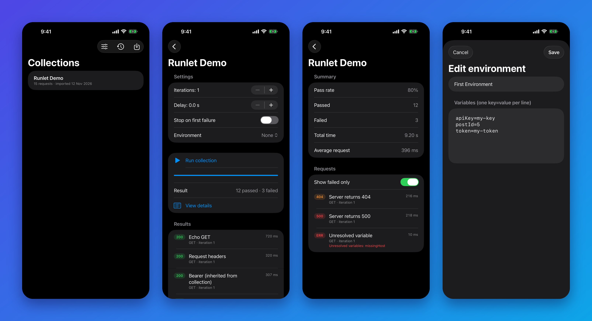
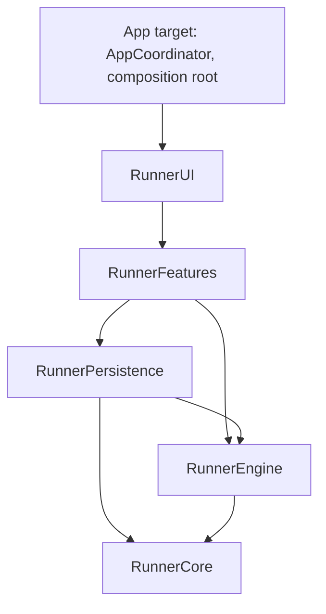

# Runlet

A Postman collection runner for iOS. Import a Postman Collection v2.x file, pick an environment,
and run every request in sequence with pause, stop and repeat controls. Every run is saved to a history you can browse later.

**Stack:** Swift, SwiftUI, SwiftData, Swift Concurrency (async/await, actors), Observation, SPM, GitHub Actions

[](https://github.com/sokolivan17/Runlet/actions/workflows/ci.yml)



## Features

- Import Postman Collection v2.0/v2.1 JSON (nested folders, string or object URLs, shorthand requests)
- `{{variable}}` substitution with collection variables, environments and nested references
- Bearer, Basic and API key auth (header or query), inherited from the collection
- Raw and `x-www-form-urlencoded` bodies   
- Sequential runs with iterations, delay, stop-on-failure and pause / resume / stop
- Persistent run history with per-request status, timing and errors
- Environments editor (`key=value` per line)

## Architecture

MVVM + Coordinator, split into Swift packages so every layer can be built and tested on its own.



| Module | Responsibility |
| --- | --- |
| `RunnerCore` | Domain models, Postman parser, variable resolver. Pure Swift, no UI or network. |
| `RunnerEngine` | Request builder, sequential run engine on async/await, `RunControl` actor for pause/stop. Network hidden behind `HTTPTransport`. |
| `RunnerPersistence` | SwiftData models behind a `@ModelActor` store. Exposes only `Sendable` value records. |
| `RunnerFeatures` | `@Observable` view models, repository and coordinator protocols. No SwiftUI. |
| `RunnerUI` | SwiftUI screens. Views own no business logic. |
| App target | `AppCoordinator` (navigation path and screen factories), dependency wiring. |

### Design decisions

- **The engine never touches `URLSession` directly.** `HTTPTransport` is injected, so run logic (ordering, pause, stop, failures) is tested with a mock and no real requests.
- **Pause and stop are cooperative.** `RunControl` is an actor checked between requests, so a stop never leaves a half-recorded result.
- **SwiftData stays behind an actor.** View models exchange `Sendable` records and never see `@Model` objects, which keeps strict concurrency checks simple.
- **The original collection JSON is stored, not a mapped tree.** It is re-parsed on load, so the parser stays the single source of truth.
- **Navigation is a protocol.** View models call `CollectionsCoordinating` / `RunnerCoordinating` / `HistoryCoordinating`; only `AppCoordinator` knows about `NavigationStack`. Tests use a spy.
- **View-model tests run against a real in-memory store** through `LiveRepository`, so the repository, store and view model are verified together.

## Getting started

Requirements: Xcode 15+ (iOS 17+ deployment target).

1. Clone the repository and open `Runlet.xcodeproj`.
2. Run the app on a simulator.
3. Import the sample collection from `Samples/Runlet-demo.postman_collection.json`
      (drag the file onto the simulator, then use the import button in the app).

## Tests

```bash
bash scripts/test-all.sh
# or a single module
swift test --package-path Packages/RunnerEngine
```

Around 60 unit tests cover the parser, variable resolver, request builder, run engine (ordering, iterations,
failures, pause, stop), persistence and every view model. CI runs each package on macOS and lints with SwiftLint.

## Limitations and roadmap

- Pre-request and test scripts are not executed
- `form-data` bodies are reported as unsupported
- Dynamic variables (`{{$guid}}`, `{{$timestamp}}`) are not implemented
- Requests run sequentially only
- Planned: assertions on status and response time, report export, dynamic variables

## License

MIT. See [LICENSE](LICENSE).
